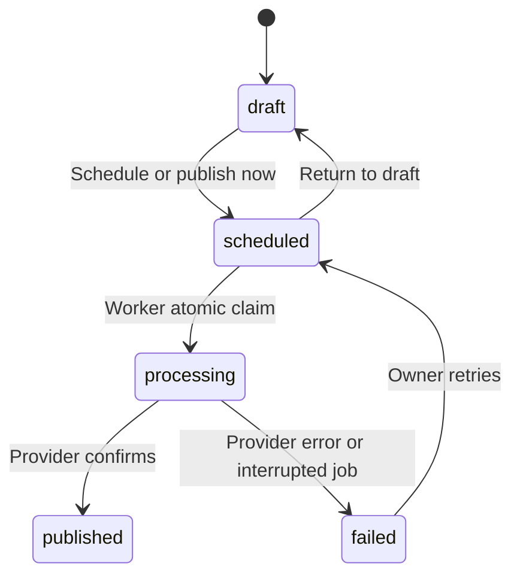

# Social Flow

[](https://github.com/simranrizvi/social-flow/actions/workflows/ci.yml)

A full-stack Instagram content studio for planning, writing, reviewing, scheduling and publishing brand content. Set a brand voice once, write manually or generate AI drafts, then manage everything from a searchable library and weekly calendar.

**Next.js · React · Node.js · Express · MongoDB · OpenAI · Instagram · n8n**

## What it does

- **Brand workspace:** cookie authentication, brand voice, audience, topics, timezone and a weekly publishing rhythm.
- **Content editor:** manual drafts, AI captions and optional JPEG artwork, editable captions/hashtags, image preview and a shared 2,200-character budget.
- **Post management:** server-side search, status filters, pagination, reopen/edit, duplicate, schedule, return to draft, delete and publish now.
- **Calendar:** browse weeks with all scheduled posts in the selected date range. Display times use the device timezone; automatic generation uses the brand timezone.
- **Publishing worker:** durable MongoDB queue, atomic post claims, separate publishing/generation loops, leased brand generation and interrupted-job recovery.
- **Integrations:** Instagram OAuth with encrypted tokens, automatic token refresh and signed n8n event delivery.
- **Engineering:** feature-based modules, validated configuration, consistent API errors, request IDs, rate limits, origin checks, integration tests, linting, formatting, CI and Docker services.

Automatic generation/publishing is **off by default**. Manual drafts work without OpenAI or Meta credentials. Real generation, OAuth and publishing require your own configured provider accounts.

## Quick start

Use **Node.js 22.13+**, npm and MongoDB 8 (or Atlas).

```bash
git clone https://github.com/simranrizvi/social-flow.git
cd social-flow
npm ci
npm run setup
# Start your MongoDB service, or: docker compose up -d mongo
npm run dev
```

`setup` creates local environment files only when absent and generates random JWT/encryption secrets. Review `.env` before starting. It never overwrites existing settings.

| Service | Local address         | Purpose                                                                  |
| ------- | --------------------- | ------------------------------------------------------------------------ |
| Web     | http://localhost:3000 | Register a workspace, create and review content                          |
| API     | http://localhost:4000 | REST API; `/api/health` for liveness, `/api/ready` for MongoDB readiness |
| Worker  | No HTTP port          | Publishes due posts and fills enabled automation queues every 30 seconds |

Create an account at `/register`. Write a manual draft under **Create content**, save it, and find it in **Post library**. For publishing, configure Meta, connect Instagram in **Brand settings** and provide a public HTTPS JPEG image.

Run processes separately when needed:

```bash
npm run dev -w @social-flow/frontend
npm run dev -w @social-flow/backend
npm run worker:dev -w @social-flow/backend
```

## Project structure

```text
frontend/
  src/
    app/                   App Router pages, layouts, error and not-found states
    components/            Shared navigation, authentication shell and icons
    features/posts/        Post editor and paginated post fetching
    lib/                   API client and structured API errors
backend/
  src/
    config/                Environment validation and database connection
    middleware/            Authentication, input validation and origin protection
    modules/
      auth/                Account routes and user model
      brands/              Brand settings and model
      dashboard/           Workspace overview queries
      integrations/        OAuth, social accounts, Instagram and n8n adapters
      posts/               Routes, controllers, schemas, model, AI and publishing
    jobs/                  Dedicated scheduler and timezone calculations
    utils/                 Error handling, async wrapper and token encryption
    app.js                 Express composition, independent of the listener
    server.js              API process with graceful shutdown
    worker.js              Worker process with graceful shutdown
  scripts/                 Explicit production index creation
  tests/                   Database-backed API and unit tests
scripts/                   Local environment setup
n8n/                       Importable event intake workflow
.github/workflows/         Automated quality checks
docs/                      Deployment, operations and migration notes
```

Routes handle HTTP concerns; post controllers coordinate validation and database updates; integration adapters isolate provider calls. Workspace filters are applied on every post read/write. The API and worker share the same models and environment but run as separate processes.

## Configuration

Backend configuration is loaded from the root `.env`; browser configuration lives in `frontend/.env.local`. Examples are committed without credentials.

| Variable                                | Usage                                                                                      |
| --------------------------------------- | ------------------------------------------------------------------------------------------ |
| `MONGODB_URI`                           | Local MongoDB or Atlas connection string                                                   |
| `JWT_SECRET`                            | Random private secret, at least 32 characters                                              |
| `TOKEN_ENCRYPTION_KEY`                  | 32-byte hexadecimal AES-256-GCM key; required for Meta                                     |
| `WEB_ORIGIN`                            | Exact browser origin, with no trailing slash                                               |
| `API_PUBLIC_URL`                        | API URL exposed to browsers and Instagram image downloads                                  |
| `NEXT_PUBLIC_API_URL`                   | Browser API base URL; supplied at frontend build time                                      |
| `TRUST_PROXY_HOPS`                      | Number of trusted reverse-proxy hops; defaults to zero                                     |
| `OPENAI_API_KEY`                        | Enables AI generation; models configurable with `OPENAI_TEXT_MODEL` / `OPENAI_IMAGE_MODEL` |
| `META_APP_ID`, `META_APP_SECRET`        | Your Instagram Login app credentials                                                       |
| `META_REDIRECT_URI`                     | Must exactly match your Meta app's allowed callback URI                                    |
| `META_GRAPH_VERSION`                    | Configurable provider API version; confirm support in your Meta app                        |
| `UPLOAD_DIR`                            | Image directory relative to `backend/`, shared by API and worker                           |
| `N8N_WEBHOOK_URL`, `N8N_WEBHOOK_SECRET` | Optional webhook URL and signing secret (16+ characters)                                   |

Production requires HTTPS origins and a private JWT secret. Keep encryption keys stable: rotating or losing the encryption key requires reconnecting social accounts. Do not commit local environment files, real tokens or database backups.

## Instagram and OpenAI

Configure an Instagram Business or Creator account and a Meta app using **Instagram Login**. Request the business basic/content publishing permissions and complete Meta's review requirements for access beyond your development roles. Set your callback URL, configure the encryption key, restart the API and connect through settings.

Images must be publicly reachable by Meta over HTTPS. AI generation requests JPEG output; externally hosted images must also meet Meta's publishing specifications. Localhost uploads cannot be fetched by Meta. See [Meta's publishing guide](https://developers.facebook.com/docs/instagram-platform/content-publishing/).

The AI assistant uses the configured OpenAI text/image models. Review factual claims and artwork before publishing. Enabling automation explicitly authorizes generation and publishing without individual review, which incurs provider usage costs.

## Publishing lifecycle



**Publish now returns `202 Accepted`**, queues a post for the next worker tick and reports final status in the library. Keep the worker running. Scheduled timestamps are stored as UTC instants. Automation creates at most three upcoming posts per brand using 1–7 publishing days per week; multiple preferred times rotate across days rather than increasing the weekly count. Nonexistent local times during a DST transition are skipped.

Each post can be claimed by one worker. A 15-minute brand lease prevents concurrent generation for a workspace. Processing jobs interrupted for more than 15 minutes move to `failed` for review. A provider may publish successfully before the connection drops: **check Instagram before retrying ambiguous failures**. Exactly-once external publishing is not guaranteed. Provider container IDs are retained for retries and reset when content is edited.

Turning off automatic generation stops creating new automatic posts. Already scheduled posts still publish; return them to drafts to cancel them.

## n8n integration

1. Import `n8n/social-flow-events.workflow.json`.
2. Activate it and copy its production webhook URL.
3. Set `N8N_WEBHOOK_URL` and a random `N8N_WEBHOOK_SECRET`; restart the API and worker.
4. Use **Brand settings → Send test event** to check delivery.
5. Add your downstream steps after the intake node.

Events include `post.created`, `post.scheduled`, `post.unscheduled`, `post.published`, `post.failed` and `integration.test`. The JSON body contains `source`, `event`, `timestamp` and `data`. Headers include `x-social-flow-event`, `x-social-flow-timestamp` and `x-social-flow-signature` (`sha256=<hex>`). Compute HMAC-SHA256 over the **exact raw request body** with the shared secret, compare in constant time and reject stale timestamps before taking actions.

The starter only acknowledges requests; configure signature verification in n8n or a trusted gateway before connecting sensitive downstream steps. Delivery is best-effort, bounded by an eight-second timeout, and does not roll back a successful post update. There is no persistent webhook outbox/replay facility.

## REST API

All workspace routes require an HTTP-only session cookie (Bearer JWT is also accepted). The API accepts JSON. Errors use `{ error: { code, message, requestId, details? } }`; responses include `X-Request-Id`.

| Method             | Route                                              | Purpose                                                          |
| ------------------ | -------------------------------------------------- | ---------------------------------------------------------------- |
| POST               | `/api/auth/register`, `/login`, `/logout`          | Create account, log in or clear session (all under `/api/auth`)  |
| GET                | `/api/auth/me`                                     | User and current workspace                                       |
| GET, PATCH         | `/api/brand`                                       | Read/update brand and automation settings                        |
| GET                | `/api/dashboard`                                   | Counts, recent content and upcoming posts                        |
| GET                | `/api/posts`                                       | Query `page`, `limit` (max 50), `status`, `search`, `from`, `to` |
| POST               | `/api/posts`                                       | Create a manual draft                                            |
| POST               | `/api/posts/generate`                              | Generate and save an AI draft (20 requests/user/hour)            |
| GET, PATCH, DELETE | `/api/posts/:postId`                               | Read, edit or delete an eligible post                            |
| POST               | `/api/posts/:postId/schedule`                      | Schedule using a future ISO UTC `scheduledAt`                    |
| POST               | `/api/posts/:postId/unschedule`                    | Return a scheduled post to draft                                 |
| POST               | `/api/posts/:postId/duplicate`                     | Copy content into a new draft                                    |
| POST               | `/api/posts/:postId/publish`                       | Queue immediate publishing; returns 202                          |
| GET                | `/api/integrations/instagram/connect`, `/callback` | Start/complete OAuth (both under `/api/integrations/instagram`)  |
| DELETE             | `/api/integrations/instagram`                      | Disconnect account and disable future generation                 |
| GET, POST          | `/api/integrations/n8n/status`, `/test`            | Check configuration / test delivery                              |
| GET                | `/api/health`, `/api/ready`                        | Process liveness / database readiness                            |

Published/processing posts cannot be edited. Only draft/failed posts can be deleted. To publish a scheduled post immediately, return it to draft first. Post date filters apply to `scheduledAt` as an inclusive start/exclusive end range. Searches match literal text in title/topic/caption.

## Quality checks

```bash
npm run lint
npm run format:check
npm test
npm run build
# All of the above:
npm run check
```

Tests start an isolated temporary MongoDB instance, exercise registration, tenant isolation, literal search, lifecycle restrictions, queue claiming and error contracts, and cover encryption, timezone/DST and validation. The first test run downloads a MongoDB binary; it needs network access. No real provider calls or credentials are used by tests.

## Deployment and existing installations

See [deployment and migration notes](docs/deployment.md) for Docker, indexes, volumes, HTTPS configuration and upgrade behavior. This implementation supports single-owner workspaces and Instagram feed images. Team invitations, approval roles, video/carousel publishing, provider analytics, distributed rate limiting, durable webhook retries and cloud object storage are future extensions rather than implemented features.
